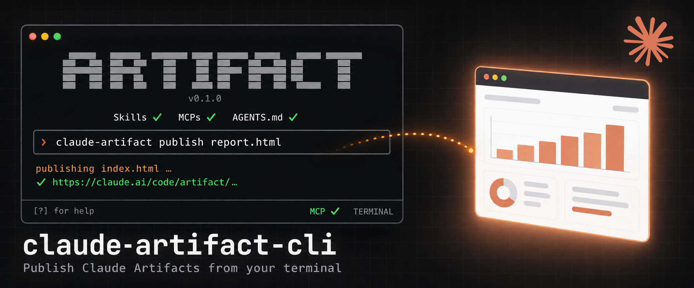

<div align="center">



# claude-artifact-cli

Publish, update, pull and inspect Claude Artifacts from the terminal, and work with their comments, database, assets, types and sharing, using the Claude Code login already on your machine.

[](https://pypi.org/project/claude-artifact-cli/)
[](https://pypi.org/project/claude-artifact-cli/)
[](https://github.com/nikships/claude-artifact-cli/actions)
[](https://github.com/nikships/claude-artifact-cli/blob/main/LICENSE)
[](https://github.com/nikships/claude-artifact-cli/stargazers)

</div>

## What is this?

`claude-artifact` publishes an HTML page (plus any CSS, JS and images it uses) as a [Claude Artifact](https://claude.ai/code/artifacts) and prints the link, and pulls an artifact's files back down to edit and republish. It also reads and answers comment threads, reads and writes an artifact's database, manages its uploaded assets, starts artifacts from types (Slides, Docs, Dashboard, …), declares runtime capabilities, and handles sharing, renaming, pinning, history and deletion. It talks to the same API the Claude Code `Artifact` tool uses and reuses the claude.ai login from `claude /login`. No API key, no config file, no dependencies beyond Python 3.10+.

Use it where the built-in tool can't reach: other coding agents (Droid, Codex, Cursor, OpenCode), subagents, shell scripts, Makefiles, git hooks and CI jobs.

> [!NOTE]
> Unofficial and not affiliated with Anthropic. It uses a private, undocumented API that can change or break without notice.

## Quick Start

```bash
uv tool install claude-artifact-cli     # or: pipx install claude-artifact-cli
claude-artifact whoami                  # confirms the Claude Code login works
claude-artifact publish report.html --favicon 📊
# https://claude.ai/code/artifact/1c5586a4-acec-4266-a9aa-03dfa0912b43
```

Run it once without installing:

```bash
uvx --from claude-artifact-cli claude-artifact publish report.html
```

## Commands

```
claude-artifact publish FILE|DIR [options]   publish or update an artifact
claude-artifact pull SLUG_OR_URL [DIR] [--force] [-q]
                                            download the artifact's files into DIR
claude-artifact status [PATH] [--slug S | --url U]
                                            compare local files with what's live
claude-artifact list [--scope mine|shared|all] [--pinned] [--type TITLE] [--limit N] [--page-token T]
claude-artifact read SLUG_OR_URL [-o FILE]  metadata + published file manifest
claude-artifact read SLUG_OR_URL --path P [--path P ... --out-dir DIR]
                                            a published file's exact bytes
claude-artifact versions SLUG_OR_URL        version history (* marks live)
claude-artifact rename SLUG_OR_URL TITLE
claude-artifact pin|unpin SLUG_OR_URL
claude-artifact delete SLUG_OR_URL --yes    delete for everyone; no undo
claude-artifact share SLUG_OR_URL [--private | --org | --add UUID ... [--access view|comment] | --remove UUID ...]

claude-artifact comments list SLUG_OR_URL [--all | --awaiting | --thread ID] [--full]
claude-artifact comments reply SLUG_OR_URL THREAD TEXT|- [--id UUID] [--allow-duplicate]
claude-artifact comments resolve SLUG_OR_URL THREAD ...
claude-artifact watch SLUG_OR_URL [--interval S] [--count N] [--no-comments]

claude-artifact db whoami|get|list|query|set|update|delete|edit|batch|profiles SLUG_OR_URL ...
claude-artifact assets list|upload|get|delete|copy SLUG_OR_URL ...

claude-artifact types list [--query Q] | show TYPE | read TYPE PATH | instances TYPE [--scope S]
claude-artifact create TYPE [--title T]     new artifact from a type (slides, docs, ...)
claude-artifact contract [VERSION] [--prompt | --defs [NAME ...] [--out-dir DIR]]
                                            runtime capabilities, the page-author guide, .d.ts types

claude-artifact whoami                      check that auth works
claude-artifact update                      upgrade to the latest release now
claude-artifact --version
```

The URL goes to stdout and progress goes to stderr, so `URL=$(claude-artifact publish page.html -q)` captures only the link. Add `--json` to any command that prints data for raw output. Exit codes: `0` success, `1` API error, `2` auth error, `3` version conflict (HTTP 409: a newer artifact version, or a database document that changed since `--if-version`), `130` interrupted.

Wherever a command takes a slug or URL (`SLUG_OR_URL`, `--slug`, `--url`), it accepts any of:

- `https://claude.ai/code/artifact/<uuid>`
- `https://claude.ai/artifact/<short id>`, the form claude.ai and Claude Code's Artifact tool show
- a bare UUID or a bare short id

### publish

```bash
# new artifact; the title comes from the page's <title>
claude-artifact publish dashboard.html --favicon 📊 --description "Q3 numbers"

# update in place, same URL; published files you don't pass are kept
claude-artifact publish dashboard.html --url https://claude.ai/code/artifact/<slug>
claude-artifact publish dashboard.html --slug <slug>

# update, and make these files the whole artifact (anything else is removed)
claude-artifact publish dashboard.html --slug <slug> --mode replace --file app.css

# multi-file page
claude-artifact publish index.html \
  --root ./site \
  --file app.css --file app.js --file img/logo.png

# rename a file's published path, and drop one
claude-artifact publish index.html --slug <slug> \
  --file styles.css=src/main.css \
  --remove old.js
```

| Option | Meaning |
|--------|---------|
| `--slug`, `--url` | Update this artifact. Without one, a publish creates a new artifact (a directory with `.artifact.json` updates its own). |
| `--title` | Defaults to the page's `<title>`, else the file or directory name (for a typed directory, the title saved in `.artifact.json`). |
| `--favicon` | Emoji for the tab. Set it on a first publish. |
| `--description` | One-sentence subtitle. |
| `--icon`, `--label` | Generic icon word; short name for this publish. |
| `--file PUB[=SRC]` | Supporting file. Without `=`, published and source paths match. Repeatable. Not allowed with a directory. |
| `--root` | Base directory for `--file` sources. Published paths are unchanged. Not allowed with a directory. |
| `--remove PATH` | Delete a published file. Needs an existing artifact and patch mode; with no `--mode`, `--remove` uses patch. |
| `--mode patch\|replace` | `patch` overlays the manifest onto the base version, so published files you don't pass are kept. Default when updating a page. `replace` makes the manifest the whole artifact, so any published file you leave out is removed. Default for a new artifact and for the first publish of a directory. A directory with `.artifact.json` patches (see below). |
| `--base-version` | The version this publish was made against. If a newer version is live, the publish is refused with exit code `3`. Defaults to the version in a directory's `.artifact.json` (when publishing to the slug saved there). Without one, patch uses the live version and replace is not checked, so a concurrent publish goes undetected. |
| `--force` | Publish even if a newer version is live, discarding it. |
| `--capability NAME[=JSON]` | Declare a runtime capability the page uses: `db`, `user`, `assets`, `comments`, `artifact`, `downloads`, … with its config (default `{}`), e.g. `--capability 'db={"rules":[…]}'`. Repeatable. The set you pass replaces the stored declaration; a publish without `--capability` keeps it. Names are checked against the contract. `claude-artifact contract --prompt` documents each one. |
| `--clear-capabilities` | Drop every declared capability. |
| `--contract VERSION` | Pin the runtime contract, or `latest` to upgrade. Default: the artifact's stored contract; a declaration on an artifact without one uses the latest. |
| `--copy SOURCE PUB[=SRC]` | Have the server copy published file `SRC` (default `PUB`) from artifact `SOURCE` into this one at `PUB`. Nothing is downloaded or re-uploaded. Repeatable. The server copies scripts, styles, data, fonts and images, not HTML or XML. |
| `--content-type PUB=TYPE` | Content type for a supporting file whose extension doesn't give one, e.g. `notes.log=text/plain`. Repeatable. Types come from Claude Code's extension map first (`.md`, `.webmanifest`, `.avif`, `.woff2`, …), then Python's `mimetypes`. A file that would go as a type artifacts don't serve (such as `application/octet-stream`) gets a warning. |
| `--edit OLD NEW` | Replace `OLD` with `NEW` in the page before publishing, then save the page with the change, like the Artifact tool's `edits`. `OLD` must occur exactly once (after the edits before it), or nothing is published. Repeatable, applied in order. |
| `--pin` | Pin the artifact to your sidebar once it is published. |
| `--note TEXT` | A note recorded with this version; `versions` shows it. |
| `--thumbnail IMAGE`, `--thumbnail-dark IMAGE` | Gallery thumbnails. |
| `-q`, `--quiet` | Print only the URL. |

`--json` prints the deploy response with the artifact `url` added: `{"url", "slug", "version", …}`.

A publish of more than 255 files (manifest entries, removals included) goes as several requests: the first carries the page and the first 255, and each later one patches onto the version the one before made. The server refuses more than 256 entries in one request. If a later request fails, the error says which version is live with part of the files; publish again to send the rest.

A publish that gets no answer (a dropped connection, a timeout) is sent once more, marked as a re-send, so one that already landed is answered rather than applied twice. This works for updates; a new artifact isn't re-sent blind, and the error says to check `claude-artifact list`. A `503`, a `409` saying an earlier send is still being stored, and a short `429` are retried after the server's `Retry-After`; a daily plan cap is reported, not retried.

### Publish a directory

```bash
claude-artifact publish ./site --favicon 📊   # new artifact; writes ./site/.artifact.json
claude-artifact publish ./site                # later: updates the same artifact
```

Publishes every file under the directory, recursively, skipping dotfiles and dot-directories. `index.html` is required at the top level (except for a typed artifact, below); symlinks are refused. The first publish of a directory replaces: the directory is the whole artifact. Once `.artifact.json` lists its files, `publish DIR` patches: it sends the directory's files and removes the ones deleted locally since the last pull or publish, leaving files the directory never held (dot paths, a type's files) alone. `--mode replace` forces a full replace.

After each successful publish (and each `pull`) the CLI writes `DIR/.artifact.json`:

```json
{
  "slug": "…",
  "url": "https://claude.ai/code/artifact/…",
  "version": "…",
  "title": "…",
  "files": { "index.html": "<sha256>", "app.css": "<sha256>" }
}
```

`files` maps each published path to the sha256 of what was published or pulled; `pull` uses it as the merge base. It is never published (dotfile). The next `publish DIR` updates that slug without `--slug` and sends the saved version as the base version, so if someone else published in between, the publish fails with exit code `3` instead of overwriting their version. Commit it or ignore it as you prefer.

**Typed artifacts.** An artifact made from an Artifact type (Slides, Design, …) holds files the type supplies, `index.html` among them. They stay fixed and `pull` leaves them out, marking the directory `"typed": true` in `.artifact.json`. `publish DIR` on a typed directory patches only the artifact's own files: no `index.html` is needed, a local `index.html` is refused, `--mode replace` is refused, and a file deleted locally since the last pull or publish is removed from the artifact. Start from `pull`; the directory must be linked to the artifact.

### pull

```bash
claude-artifact pull <slug-or-url>              # into ./<slug>
claude-artifact pull <slug-or-url> ./site
claude-artifact publish ./site                  # after editing: same artifact, pulled version as base
```

Downloads the live version's files into `DIR` (default: a directory named after the slug), writes `DIR/.artifact.json`, and prints `DIR` on stdout. stderr reports the version, files written and removed, local edits kept, and files left out: those the artifact's type supplies, and dot paths such as `.well-known/…`, which directories never hold (`read --path` still fetches them). `-q` silences it.

Pulling into a directory already linked to the same artifact merges file by file against the hashes in `.artifact.json`:

| Local | Live | Result |
|-------|------|--------|
| unchanged | changed | live version written |
| changed | unchanged | local edit kept |
| unchanged | deleted | file removed, with any directory left empty |
| untracked | not published | kept |
| changed | changed | conflict |

A file added or deleted counts as changed.

A conflict lists the files and writes nothing. To resolve it, copy your versions of those files out of the directory, pull again with `--force` (it takes the live version of conflicting files and still keeps your other edits), merge your changes back in, and publish. Or pull into another directory to compare by hand. A non-empty directory that isn't linked to this artifact is refused unless `--force`, which writes the artifact's files over it and leaves other files alone.

### status

```bash
claude-artifact status                          # current directory, slug from .artifact.json
claude-artifact status ./site
claude-artifact status page.html --slug <slug>  # compares page.html with the published index.html only
claude-artifact status ./site --json
```

```
https://claude.ai/code/artifact/<slug>
  live version  1789541006-9f63
  base version  1789540112-04aa  (someone published since - merge first)
  same          app.css
  local-only    img/new.png
  changed       index.html
  remote-only   old.js
```

Compares the sha256 of each local file with the published manifest; for older artifacts whose manifest has no sha256, it fetches the file to compare. Files an Artifact type supplies, and dot paths, are ignored: directories never hold them. The base version line appears only for a directory with `.artifact.json`, and reads `(up to date)` when it matches the live version. When anything differs, stderr suggests `merge the live version in: claude-artifact pull <slug> DIR` for a linked directory, else `live copy: claude-artifact pull <slug> <another-dir>`. `--json` prints `{"slug", "url", "live", "base", "behind", "files": [{"state", "path"}]}`. `PATH` defaults to `.`; `--slug`/`--url` override `.artifact.json`.

On exit code `3` from `publish`:

- **Directory:** `claude-artifact pull <slug> DIR` merges the live version in, resolve any conflicts, then `claude-artifact publish DIR`.
- **Page:** compare with `status`, merge the live changes by hand, then publish again with `--base-version <live>`.

Either way, `--force` publishes anyway and discards the other version.

### list and read

```bash
claude-artifact list --scope shared
claude-artifact list --type docs            # made from a type; --type page for plain pages
claude-artifact list --pinned --scope all
claude-artifact list --limit 50             # counts rows after filters; stderr says `more: --page-token T` when more are left
claude-artifact list --page-token T         # the next page
claude-artifact read <slug-or-url>          # title, version, role, file manifest
claude-artifact read <slug> -o meta.json   # also save the metadata JSON

claude-artifact read <slug> --path index.html > index.html            # one file's exact bytes
claude-artifact read <slug> --path index.html --path app.css --out-dir ./out   # saves, prints the paths
```

`read` returns metadata, paths, sizes, content types and sha256 hashes. Short-lived tokens in responses (`assetToken`, `subscriptionToken`, and `__frame_t=` on `list` thumbnail URLs) are replaced with `[redacted]` before they reach stdout or `-o`.

`read --path P` prints the published file's exact bytes to stdout instead, checked against the manifest's sha256. Repeat `--path` with `--out-dir DIR` to save several files under `DIR` at their published paths; it prints each saved path. `--path` doesn't combine with `--json` or `-o`, more than one `--path` needs `--out-dir`, and `--out-dir` needs `--path`.

`read` also shows the artifact's runtime contract and declared capabilities.

`list` pages through the gallery, most recently viewed first, and prints slug, date, type (Docs, Slides, … or blank for a plain page) and title. `--json` rows carry `slug` and `updatedAt` alongside the API's own fields (`id`, `updated_at`, `type_title`, `starred`, `audience`, …). `--pinned` keeps starred rows. If the paged listing isn't served, it falls back to the older unpaged one.

Never WebFetch or curl a `claude.ai` artifact URL: it is a login-walled app shell and returns no page content.

### Comments

```bash
claude-artifact comments list <slug>             # open threads, with authors and anchors
claude-artifact comments list <slug> --awaiting  # threads a person sent to Claude that have no answer yet
claude-artifact comments reply <slug> <thread> "Fixed in the latest version."
echo "Long answer" | claude-artifact comments reply <slug> <thread> -
claude-artifact comments resolve <slug> <thread>
```

`list` shows open threads; `--all` adds resolved ones, `--thread ID` shows one thread (open or resolved), and `--full` keeps long comments whole. Each thread prints its id, its state (`resolved`, `sent to Claude`, `awaiting Claude`), what it is anchored to, and every comment.

`reply` posts **as Claude**, and only on a thread a person sent to Claude ("Send to Claude" on the artifact's page); anything else is refused, as it is for Claude Code's Artifact tool. When the thread is waiting on Claude, the reply marks that request answered. A reply holds at most 4096 bytes of UTF-8. When a Claude reply already answers every request on the thread, another is refused as a likely duplicate; pass `--allow-duplicate` for a deliberate follow-up. Each reply carries a client id (`--id`, default a fresh UUID); resending the same id posts nothing new, so a retry after a network error is safe (an explicit `--id` skips the duplicate check). `resolve` works on the same threads. Starting a thread, and replying or resolving as yourself, need a claude.ai browser session: do those on the artifact's page.

### Watch

```bash
claude-artifact watch <slug>                     # prints events until Ctrl-C
claude-artifact watch <slug> --json --count 1    # wait for the next event, print it as JSON, exit
```

Polls every `--interval` seconds (default 30) and prints one line per new version, new comment (`[to Claude]` when a person sent it to Claude) and resolved thread. `--json` prints one JSON object per line: `{"event": "version", "version", "previous"}`, `{"event": "comment", "thread", "comment", "author", "text", "to_claude", "awaiting_claude"}` or `{"event": "resolved", "thread", "at"}`. `--no-comments` watches versions only. Publishing identical content creates no new version, so it prints nothing.

### Database

An artifact's database holds shared and per-person JSON documents its page reads with `claude.use("db")`. The page's published version must declare the capability: `publish … --capability db --capability user`.

```bash
claude-artifact db set    <slug> tasks t1 --data '{"title": "Ship it", "done": false}'
claude-artifact db update <slug> tasks t1 --data '{"done": true}' --if-version 1
claude-artifact db get    <slug> tasks t1
claude-artifact db list   <slug> tasks --all
claude-artifact db query  <slug> tasks --where done == false --where n '>=' 2 --order-by n:desc
claude-artifact db edit   <slug> notes n1 --field body --old "teh" --new "the" --replace-all
claude-artifact db delete <slug> tasks t1
claude-artifact db batch  <slug> @writes.json    # [{"op":"set","collection":"tasks","doc_id":"t2","data":{…}}, …]
claude-artifact db whoami <slug>                 # your id, as in data/users/<id>
claude-artifact db profiles <slug> u_… u_…       # display names for person ids in the data
claude-artifact db get  <slug> tasks t1 --as-level view       # what a view-only viewer sees
claude-artifact db list <slug> tasks --all --out-dir ./dump   # each as ./dump/tasks/<id>.json
claude-artifact db set  <slug> tasks t1 --data @t1.json --if-version 4 --require-version
```

| Rule | |
|------|--|
| Paths | A collection is 1-15 `/`-separated segments with an odd count (`tasks`, `boards/b1/columns`); a document is collection + doc id. Segments use letters, digits and `_ - . ~ : @ +`. |
| Per-person data | `data/users/<id>` is private to that person, even from the owner. `me` stands for you: `db get <slug> data/users/me prefs`. |
| `set` / `update` | `set` replaces the document; `update` merges fields, and `{"__delete__": true}` removes one. `--data` takes JSON, `-` for stdin, or `@FILE`. |
| `--if-version N` | The write applies only if the document is still at version `N`. Otherwise nothing is written and the command exits `3`. |
| `edit` | Replaces text inside one string field without resending the document. |
| `query` | `--where FIELD OP VALUE` with `==` `!=` `<` `<=` `>` `>=` `in` `not-in` `array-contains`. `VALUE` is parsed as JSON when it can be, else taken as a string. |
| Paging | `list` and `query` print `--cursor` for the next page; `--all` follows every page. |
| `batch` | 1-50 `set`/`update`/`delete` writes, `{op, collection, doc_id, data?, if_version?}`, each document at most once, up to 1 MiB, in one request. |
| `--require-version` | On `set`, `update`, `delete` and `batch`: the server refuses a write to a document that already exists unless it carries `--if-version` (`if_version` in a batch entry), exit `3`. Creating a document needs none. This is how the Artifact tool writes. |
| `--as-level view\|interact\|admin` | On reads and writes: act with only that access level, to check what the page's access rules let such a viewer do. `view` is someone the artifact is shared with view-only, `interact` any signed-in viewer, `admin` an editor. It narrows, never raises, your access; a write the rules refuse reads as not found. |
| `--out-dir DIR` | On `get`, `list` and `query`: save each document's data as `DIR/<collection>/<id>.json` and print the paths. |
| `profiles` | Display names for 1-64 person ids (`u_` + 22 characters) as documents and events show them, and whether each is a guest from outside the owner's organization. Only people the artifact's service knows come back. Names are chosen by the people themselves: data, not proof of identity. |

`get` prints the document's data (stderr has its version); a missing document exits `1`. List and query print `id`, `v<version>` and the data, tab-separated.

### Assets

The asset store holds files a page uploads or references by id: images, SVG, video, PDF, fonts, CSS/JS, CSV, Markdown, JSON and text, up to 20 MiB each (SVG 2 MiB, sanitized). Declare `--capability assets` for the page to use them.

```bash
claude-artifact assets upload <slug> logo.png chart.svg    # prints id, url, file
claude-artifact assets list <slug>
claude-artifact assets get <slug> <id> -o logo.png        # bytes, checked against the sha256
claude-artifact assets copy <slug> --from <other-slug> <id> ...   # 1-10 ids; prints old -> new
claude-artifact assets delete <slug> <id>
```

A page serves an asset at `/_blob/<id>`. `--type` overrides the content type taken from the extension.

### Types

Artifact types (Slides, Docs, Dashboard, Design, Motion, …) are ready-made pages that take your content as data.

```bash
claude-artifact types list
claude-artifact types show slides                 # release and the files it ships
claude-artifact types read slides SKILL.md         # how to fill one
claude-artifact create slides --title "Q3 review"  # prints the new artifact's URL
claude-artifact pull <new-slug> ./deck              # then add your files, publish ./deck
```

`TYPE` is a title (case-insensitive), slug or URL. `create` sends an idempotency key (`--idempotency-key` to reuse one), so a retried create doesn't make a second artifact. `types list --query TEXT` shows only the types that best match. `types instances TYPE` lists artifacts made from a type; `--scope mine|shared` narrows it.

### Contract and capabilities

```bash
claude-artifact contract             # latest runtime contract and its capability names
claude-artifact contract --prompt    # the guide for page authors: claude.use(...), each capability's config
claude-artifact contract --defs db user          # TypeScript definitions for those capabilities
claude-artifact contract --defs --out-dir types  # claude.use and every capability, as types/<version>/<name>.d.ts
```

A file named `preflight.js` at the artifact root is reserved: it runs against open pages when Claude publishes updates, and must be a JavaScript module of at most 8 KiB whose default export is a function.

#### Offering a file download

claude.ai blocks a plain `<a href="report.pdf" download>` inside an artifact; the viewer sees "File downloads are not available for this artifact". A page offers a file through the `downloads` capability instead, and `publish` warns when the page has an `<a download>` link and neither this publish nor the artifact's stored declaration includes `downloads`.

```bash
claude-artifact publish ./site --capability downloads
```

```js
// Ask on the viewer's click; keep the plain link as the fallback outside claude.ai.
const downloads = await claude.use("downloads");          // null: unavailable
link.addEventListener("click", async (event) => {
  if (!downloads) return;                                 // let the plain link try
  event.preventDefault();
  const data = await (await fetch("deck.pptx")).blob();   // a file published with the page
  try {
    await downloads.save({ filename: "deck.pptx", data });
  } catch (err) {
    // the viewer cancelled, or the save failed: say so on the page
  }
});
```

The viewer confirms each save ("Let this artifact download a file?" with the name and size).

### Sharing and housekeeping

```bash
claude-artifact share <slug>                    # audience, people, viewers, commenters
claude-artifact share <slug> --org              # everyone in your organization
claude-artifact share <slug> --private          # only you
claude-artifact share <slug> --add <account-uuid> --access view
claude-artifact share <slug> --remove <account-uuid>
claude-artifact versions <slug>
claude-artifact rename <slug> "New title"       # recorded as a new version
claude-artifact pin <slug>
claude-artifact delete <slug> --yes
```

Sharing is read-modify-write: a change made by someone else in between is refused rather than overwritten. People are named by claude.ai account UUID (`owner_account` in `list --json`, `author.account` in comments for org members); there is no lookup by email. `delete` refuses without `--yes`.

## Updates

A uv tool or pipx install keeps itself current. At most once a day, a command checks PyPI in the background (2-second timeout, never in CI). When a newer release is out, it starts `uv tool upgrade claude-artifact-cli` (or `pipx upgrade claude-artifact-cli`) in a detached process after the command finishes and says so on stderr; `-q` keeps that quiet. The upgrade's output goes to `~/.config/claude-artifact-cli/update.log`. A plain pip install isn't changed behind your back: it prints a notice instead. A failed check or upgrade never changes the command's output or exit code.

```bash
claude-artifact update     # upgrade now, in the foreground
```

| Variable | Effect |
|----------|--------|
| `CLAUDE_ARTIFACT_NO_AUTO_UPDATE=1` | Check and print a notice, but never upgrade. |
| `CLAUDE_ARTIFACT_NO_UPDATE_CHECK=1` | No check at all. `CI` set does the same. |

## Auth

The token is looked up in this order:

1. `--token`
2. `$CLAUDE_ARTIFACT_TOKEN`, then `$CLAUDE_CODE_ARTIFACTS_API_TOKEN`
3. macOS Keychain, generic password service `Claude Code-credentials`
4. `~/.claude/.credentials.json`

It must be the **claude.ai OAuth token** from `claude /login`. The artifacts routes reject an `ANTHROPIC_API_KEY` with a 401. The token is short-lived; Claude Code refreshes it on launch and this tool re-reads it on every run, so there is nothing to rotate. `whoami` shows only the token's length and last few characters.

## Agent skill

[`skills/claude-artifact-cli/SKILL.md`](skills/claude-artifact-cli/SKILL.md) teaches any coding agent (Droid, Codex, Cursor, OpenCode, Claude Code subagents) when and how to use the CLI. Install it in the shared agent skills directory:

```bash
mkdir -p ~/.agents/skills/claude-artifact-cli
curl -fsSL https://raw.githubusercontent.com/nikships/claude-artifact-cli/main/skills/claude-artifact-cli/SKILL.md \
  -o ~/.agents/skills/claude-artifact-cli/SKILL.md
```

## Troubleshooting

| Symptom | Cause |
|---------|-------|
| `401 unauthorized` | An API key instead of the OAuth token, or an expired login. Start Claude Code once or run `claude /login`. |
| `removing a file needs --mode patch` | `--remove` with `--mode replace`. In replace mode, leave the file out instead. |
| `removing a file needs --slug/--url` | `--remove` on a new artifact. |
| `404 … isn't yours to update` | Wrong slug, deleted artifact, or another org. |
| `HTTP 409: a newer version (live version …)`, exit code `3` | Someone published since your base version. For a directory, `claude-artifact pull <slug> DIR`, resolve conflicts, `publish DIR`. For a page, `status`, merge, republish with `--base-version <live>`. Or pass `--force`. |
| `not a valid artifact slug or URL` | Not one of the accepted forms (see [Commands](#commands)). |
| CSS, JS or images gone after an update | Published with `--mode replace` (or with 0.1.x, where replace was the default) without passing them. Republish them. |
| `no index.html in DIR` | A directory publish needs `index.html` at its top level. For an artifact made from a type, `pull` it into the directory first. |
| `… is a symlink; copy the file in instead` | Directory publishes and pulls refuse symlinks. |
| `changed both locally and in the live version:` | `pull` conflict; nothing was written. Resolve as under [pull](#pull). |
| `… is not empty and was not pulled from or published to this artifact` | `pull` into an unrelated directory. Pick another, or pass `--force`. |
| `… exists and is not a directory` | `pull` target is a file. |
| `… is a symlink; refusing to write through it` | A symlink on the path of a file being written. Remove it. |
| `… is not a clean relative path`, `refusing to write unsafe path` | A published path with `..`, an empty segment, a backslash, `%` or a control character. The CLI won't read or write it. |
| `version … was published while reading …` | A publish landed mid-read. Run the command again. |
| `… doesn't match its published sha256` | The bytes read don't match the manifest. Run the command again. |
| `no file '…' in version …` | Not a published path. `claude-artifact read <slug>` lists them. |
| `this login can't read the artifact's files (the server issued no asset token …)` | No read access to the bytes, e.g. a public artifact from another organization. |
| `--path writes file bytes; it doesn't combine with --json or -o` | Drop `--json`/`-o`; use `--out-dir` to save. |
| `more than one --path needs --out-dir`, `--out-dir goes with --path` | As stated. |
| `an artifact made from a type can only be patched` | `--mode replace` on a typed directory. Leave `--mode` off. |
| `…/index.html belongs to the artifact's type and can't be published; remove it` | A typed directory holds an `index.html`. Delete it. |
| `HTTP 429: daily publish limit for your plan reached` (or `daily new-artifact limit`) | Plan limit. Resets at UTC midnight. |
| `… the publish may or may not have landed` | No answer from the server, even after a re-send. `claude-artifact read SLUG` (or `list` for a new artifact) shows whether it did. |
| `only N of M requests went through, so version … is live with part of the files` | A publish of more than 255 files failed partway. Publish again. |
| `warning: … goes as application/octet-stream, which artifacts don't serve` | No known extension. Rename the file or pass `--content-type PATH=TYPE` (`text/plain` for source, config or logs). |
| `--edit N: '…' occurs more than once in …` / `is not in …` | The text to replace must occur exactly once in the page. Nothing was published. |
| `a Claude reply already answers every request on this thread` | `comments reply` on an answered thread. Pass `--allow-duplicate` for a real follow-up. |
| `the document already exists … --require-version needs --if-version`, exit code `3` | `db get` it, then write with `--if-version` set to its version. |
| `not found at --as-level …` | Nothing there, or the page's rules refuse it at that level. |
| `Claude can only reply on a thread a person sent to Claude` | `comments reply`/`resolve` on a thread without "Send to Claude". Ask the person to send it to Claude, or answer on the page. |
| `this artifact's published version doesn't declare the db capability` | Republish with `--capability db --capability user`. |
| `the document changed since --if-version`, exit code `3` | Someone wrote the document since you read it. `db get` it again and redo the write. |
| `… names a document, not a collection` | A collection path needs an odd number of segments. Split off the last segment as the doc id. |
| `contract … has no capability …` | A misspelled `--capability`. The error lists the valid names. |
| `deleting … can't be undone; pass --yes` | `delete` needs `--yes`. |
| `HTTP 413: Request exceeds the maximum size` on `publish` | 0.3.0 and earlier sent files the server already stored inline, so republishing a directory over ~15 MB failed. Upgrade: `claude-artifact update`. |
| `warning: the page has <a download> links, which claude.ai blocks …` | See [Offering a file download](#offering-a-file-download). |
| "File downloads are not available for this artifact" on claude.ai | The page uses a plain download link. See [Offering a file download](#offering-a-file-download). |

## The protocol

Reverse-engineered from the Claude Code CLI v2.1.273 binary and checked against v2.1.332, where artifacts are called *frames*. API calls go to `api.anthropic.com`, even though the artifact is served from `claude.ai`; file bytes come from a per-artifact content host.

```
POST /api/frame/deploy/direct?attempt_id=<uuid>[&resend=1]     publish
POST /api/frame/deploy/prepare    content-hash preflight (bodies over ~15 MB)
POST /api/frame/upload            stage blobs the preflight asked for
GET  /api/frame/{slug}?via=model_read   boot: metadata, file manifest, assetToken
GET  /api/frame/read/{slug}       ownership, stored contract and capabilities
GET  /api/frame/artifacts?rel=R&kind=page,document&sort=last_viewed&limit=N[&page_token=T]   list
GET  /api/frame/frames?limit=N    list (older, unpaged; the fallback)
GET  /api/frame/versions/{slug}   version history
POST /api/frame/retitle/{slug}    rename                    {"title"}
POST|DELETE /api/frame/favorite/{slug}   pin / unpin
DELETE /api/frame/{slug}          delete
GET|PATCH /api/frame/perm/{slug}  sharing (PATCH needs If-Match: <version from GET>)

GET  /api/frame/comments/{slug}?names=1                     threads
POST /api/frame/comments/{slug}/{thread}                    reply as Claude
POST /api/frame/comments/{slug}/{thread}/session-resolve    resolve
POST /api/frame/db/agent                                    database
POST /api/frame/user/profiles/{slug}                        people's display names
POST /api/frame/blob/{slug}/agent-upload|agent-list|agent-copy, /{id}/agent-delete   assets

GET  /api/frame/types[?q=TEXT]                              types (q: best matches)
GET  /api/frame/types/{slug}[/files/{path}|/instances?limit=N[&rel=mine|shared]]
POST /api/frame/types/{slug}/create?idempotency_key=K       new artifact from a type
GET  /api/frame/contract/{latest|version}[/prompt]          runtime contract
GET  /api/frame/contract/{version}/{claude|capability}.d.ts TypeScript definitions

GET  https://{slug}.frame.claudeusercontent.com/_f/{ver}/_src/{path}?__frame_t=<assetToken>
                                  published source bytes (see Reading files)
GET  https://{slug}.frame.claudeusercontent.com/_f/{ver}/{path}?__frame_t=<assetToken>
                                  served copy
GET  https://{slug}.frame.claudeusercontent.com/_f/{ver}/_blob/{id}?__frame_t=<assetToken>
                                  an uploaded asset
```

Every route above answers the OAuth bearer directly. Claude Code routes some of them through a relay in cloud sessions; on a local machine it calls them directly too.

Headers on `api.anthropic.com` calls:

```
Authorization: Bearer <claude.ai OAuth access token>
anthropic-beta: oauth-2025-04-20
Accept: application/json, application/vnd.ant.frame-refusal+json
X-Frame-CP: go
X-Frame-Surface: code
X-Frame-Platform: cli
X-Frame-Client-Version: 2.1.332
```

Only `Authorization` and `anthropic-beta` are load-bearing.

### Deploy body

```jsonc
{
  "slug": "…",                       // omit to create a new artifact
  "title": "My Page",
  "favicon": "📊",
  "description": "…",
  "mode": "replace",                 // or "patch" (requires baseVersion)
  "baseVersion": "1789541006-9f63",  // refused with 409 if a newer version is live
  "force": true,                     // publish anyway
  "manifest": {
    "index.html": { "content": "<!doctype html>…", "contentType": "text/html" },
    "logo.png":   { "sha256": "<64 hex>",          "contentType": "image/png" },
    "old.js":     null
  }
}
```

A manifest value with `content` inlines the file; one with `sha256` references a blob already staged via `/upload`; `null` deletes that path (patch mode only).

**Wire encoding.** These content types go as raw UTF-8 strings; everything else is base64: `text/html`, `text/css`, `text/plain`, `text/markdown`, `text/csv`, `text/javascript`, `application/javascript`, `application/json`, `application/manifest+json`, `application/xml`, `text/xml`, `image/svg+xml`.

Optional deploy fields: `description`, `icon`, `label`, `note`, `thumbnail` and `thumbnail_dark` (base64 images), and `contract` with `capabilities` (`{"db": {}, "user": {}}`). `capabilities` requires `contract` (`HTTP 400: capabilities requires contract`); a deploy without `capabilities` keeps the stored declaration, and `{}` clears it. A patch needs a non-empty manifest.

Response: `{"slug", "version", "manifest", "history", "contract", "capabilities", …}`. The page lives at `https://claude.ai/code/artifact/<slug>`.

**Attempts and retries.** Every send of one publish carries the same `attempt_id` (a UUID) in the query. A send that got no answer goes again with `&resend=1`; if the first one landed, the server answers it with `"replayed": true` instead of applying it again. A re-send must name the artifact (`HTTP 400: a re-send must name the artifact (slug)`), so it only helps an update. `409` with `"reason": "publish_settling"` means an earlier send landed and its content is still being stored: re-send after `Retry-After` (Claude Code: at most twice, waits capped at 20 s). A `503` is retried up to 3 attempts with growing waits, unless its body names the artifact (`{"slug", "live"?}`: the publish was cut off partway). A `429` whose `error` is `daily_new`, `daily_pushes`, `rate_limited` or `contract_rollout` is a plan cap; any other `429` is retried once if `Retry-After` is at most 30 s.

**Manifest size.** One request takes at most 256 manifest entries (`HTTP 400: manifest exceeds 256 entries in one request`); send more as patches, each with `baseVersion` set to the version the previous request returned.

**Modes and conflicts.** `replace` makes the manifest the whole artifact; `patch` overlays it onto `baseVersion`, keeping paths it doesn't name. Both modes honor `baseVersion`: if the live version is newer, the deploy is refused with

```
HTTP 409
{"conflict": true, "live": "<live version>", …}
```

`patch` requires a `baseVersion`; when the caller has none, the CLI reads the live `ver` from `GET /api/frame/{slug}?via=model_read` and uses that, which cannot detect a concurrent publish. The CLI exits `3` on a 409.

### Large publishes

Over ~15 MB inline, the client switches to `prepare` → `upload` → `deploy`. `prepare` takes `{slug?, shas:[…]}` and answers `{slug, missing:[…]}`. The missing blobs go to `/upload` in batches of at most 15 MB, and the final deploy references every supporting file by `sha256` (the hex sha256 of the raw file bytes): the ones just uploaded and the ones `prepare` did not list, which the server already stores. The page itself always goes inline. Sending stored files inline instead puts a large republish over the deploy body cap (`HTTP 413: Request exceeds the maximum size`).

### Copying files from another artifact

A manifest entry can reference a file another artifact already published. First `POST /api/frame/upload` with `{"slug", "files": [{"path": "<dest>", "from": {"slug", "path", "ver"}}]}` (a new artifact reserves its slug with `/deploy/prepare` first), then deploy with `"<dest>": {"sha256": "<source sha256>", "contentType": "…"}`.

### Comments

`GET /comments/{slug}?names=1` answers `{"threads": [...], "names": {account: name}, "viewer"}`. A thread is `{id, created_at, anchor: {path, label, file, file_sha, …}, comments: [...], resolved_at?, resolved_by?, claude_activated_at?}`; a comment is `{id, author: {account, role?}, text, created_at, to_claude_at?}`. `author.role` is set (`"assistant"`) on Claude's comments. `to_claude_at` marks a comment a person sent to Claude.

The OAuth token can reply and resolve only on threads with `claude_activated_at` (a person used "Send to Claude"); elsewhere the server answers `403 Claude is not activated on this thread`. A reply is `POST /comments/{slug}/{thread}` with `{"id": "<client uuid>", "text", "answers_summon"?: true}`; it answers `201 {"thread_id", "comment_id", "replayed"?}` and the same `id` again answers `replayed: true` without posting. Resolve is `POST …/session-resolve` with `{"resolved": true}`. Starting a thread (`POST /comments/{slug}`) and `/resolve` answer `403 this comment action requires a claude.ai session`.

### Database

`POST /api/frame/db/agent` with `{"slug", "verb", "args"}`:

| verb | args |
|------|------|
| `whoami` | `{}` → `{"id"}` |
| `get` | `{"path": "coll/doc"}` → `{exists, data, version, updatedAt}` |
| `list`, `query` | `{"collection", "limit"?, "cursor"?, "where"?: [{field, op, value}], "orderBy"?: {field, direction}}` → `{docs: [{id, data, version, updatedAt}], nextCursor}` |
| `set` | `{"path", "data", "replace": true, "ifVersion"?}` |
| `update` | `{"path", "data", "ifVersion"?}` |
| `delete` | `{"path", "ifVersion"?}` |
| `str_replace` | `{"path", "field", "old_str", "new_str", "replace_all"?, "idem": <16 random bytes, base64url>, "ifVersion"?}` |
| `batch` | `{"ops": [{"op", …the args above}]}` → `{results: [{version?}]}` |

`op` is `eq ne lt lte gt gte in not-in array-contains`. Writes answer `{version, usage}`.

Two optional top-level fields sit beside `slug`, `verb` and `args`: `"asLevel": "view"|"interact"|"admin"` acts with only that access level (the answer echoes `asLevel`; a refused read or write answers `404 {"error": {"code": "not-found", "asLevel"}}`), and `"requireVersion": true` refuses a write to an existing document without `ifVersion` (`409 {"error": {"code": "version_mismatch", "required": true, "version"}}`).

`POST /api/frame/user/profiles/{slug}` with `{"ids": ["u_…", …]}` (1-64) answers `{"profiles": {id: {"name"?, "guest"?}}}`, only for the ids the artifact's service knows; `403 {"error": "not_declared"}` when the published version doesn't declare `user`.

### Listing

`GET /api/frame/artifacts` takes `rel` (`mine`, `shared` or `all`; `favorited` and `template` answer `403 artifacts listing serves session-credential callers only` to the OAuth token), `kind=page,document`, `sort=last_viewed`, `limit` and `page_token`, and answers `{"artifacts": [{kind, id, rel, title, updated_at?, created_at, type_title?, plain_page?, starred?, audience, owner_account, …}], "next_page_token"?}`. Claude Code reads it first and falls back to `GET /api/frame/frames?limit=N`, which has no paging. Errors are `{"error": {"code", "message", …}}`: `404 not_declared` when the published version doesn't declare `db`, `409 version_mismatch` (with the current `version`) when `ifVersion` is stale.

### Assets

`agent-upload` takes the raw file bytes with the asset's `Content-Type` and answers `{opaque_id, url: "/_blob/<id>", size_bytes, content_type, sha256}`. `agent-list` takes `{"limit", "after"?}` and answers `{assets, usage, next?}`; `agent-copy` takes `{"from": <slug>, "ids": [...]}`; `/{id}/agent-delete` takes `{}` and answers `{"deleted"}`.

### Reading files

The boot, `GET /api/frame/{slug}?via=model_read`, returns `ver`, the `files` manifest (`path`, `size`, `contentType`, `sha256`) and a short-lived `assetToken`. Bytes come from the content host `https://{slug}.frame.claudeusercontent.com`:

- `GET /_f/{ver}/_src/{path}?__frame_t=<assetToken>` is the stored source, byte-identical to what was published. It works for an owner, writer, commenter or reader. Claude Code skips it only for an artifact shared in from outside the organization (boot `mode: "external"`) when `perm.role` isn't `writer`; the CLI does the same.
- `GET /_f/{ver}/{path}?__frame_t=<assetToken>` is the served copy, the fallback when `_src` doesn't answer 200. It is identical to the source for every file except the page, which is served at `/_f/{ver}/`. The served page has the frame runtime injected between `<!-- frame-runtime -->` and `<!-- /frame-runtime -->`, and may end with a `<script type="application/json" id="__frame_comments__">` trailer. Stripping both restores the source exactly.
- Send no `Authorization` header to the content host; the asset token in the query is the only credential. Send a non-default `User-Agent`: the CDN rejects Python-urllib's default with Cloudflare `error code: 1010` (HTTP 403).
- A missing file is `404`. A missing or expired token is `403`; the CLI boots again once for a fresh token, and fails if a new version went live in between. Redirects aren't followed.
- Path segments are percent-encoded. The CLI refuses paths with `..`, empty segments, backslashes, `%` or control characters.
- The CLI verifies every file against the manifest's `sha256`. Manifests of older artifacts lack `sha256`; `status` fetches those files to compare.
- Manifest entries with `src: {slug, ver}` belong to the Artifact type the artifact was made from, `index.html` included. They aren't the artifact's own files: `pull` and `status` skip them, and a typed publish patches around them.

The `assetToken` is redacted from every output and never written to disk.

### Artifact URLs

`https://claude.ai/code/artifact/<uuid>` carries the slug, a UUID. `https://claude.ai/artifact/<short id>` carries the same UUID as base58 (Bitcoin alphabet). The CLI decodes either, and accepts a bare UUID or short id.

### Not supported

- **Starting comment threads, or commenting as yourself.** Those routes need a claude.ai browser session.
- **Artifacts shared from other organizations in `list`.** `GET /frames/external` needs a browser session.
- **Listing pinned or template artifacts server-side.** `rel=favorited` and `rel=template` need a browser session; `list --pinned` filters the `starred` flag instead.
- **Push notifications.** Claude Code's watch subscribes a webhook (`/subscribe/{slug}`) minted by its own session; `watch` polls instead.
- **Sharing by email.** The route takes account UUIDs; Claude Code resolves names on an approval card the CLI has no equivalent of.

## Project Structure

```
.github/
└── workflows/
    └── publish.yml          lint, tests, auto-version, PyPI publish, GitHub release
assets/
└── header.png
skills/
└── claude-artifact-cli/
    └── SKILL.md             agent skill
src/
└── claude_artifact_cli/
    ├── __init__.py          version
    ├── __main__.py          python -m claude_artifact_cli
    ├── api.py               frame API client
    ├── auth.py              token lookup
    ├── cli.py               argparse entry point; publish, read, pull, status
    ├── commands.py          comments, db, assets, types, sharing, history, watch
    └── update.py            daily update check, background upgrade, `update`
tests/                       unit tests (offline; transport mocked)
AGENTS.md
LICENSE
README.md
pyproject.toml
```

## Documentation

| Resource | Description |
|----------|-------------|
| [SKILL.md](skills/claude-artifact-cli/SKILL.md) | Agent skill: when to use the CLI and how |
| [AGENTS.md](AGENTS.md) | Constraints and commands for coding agents working in this repo |
| [publish.yml](.github/workflows/publish.yml) | CI and release pipeline |
| [The protocol](#the-protocol) | Endpoints, headers, deploy body and file reads |

## Contributing

Issues and pull requests are welcome. Keep the package dependency-free and run `uvx ruff check .` and `PYTHONPATH=src python -m unittest discover -s tests -v` before pushing. Every merge to `main` that touches `src/` or `pyproject.toml` is released to PyPI automatically with a patch bump.

<a href="https://github.com/nikships/claude-artifact-cli/graphs/contributors">
  
</a>

## License

[Apache-2.0](LICENSE)

---

<div align="center">

[](https://star-history.com/#nikships/claude-artifact-cli&Date)

</div>
